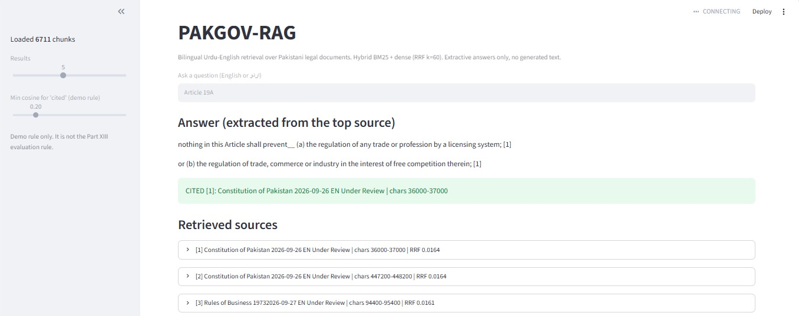
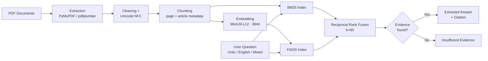

<div align="center">


# 🇵🇰 PAKGOV-RAG

### Bilingual (Urdu + English) Retrieval-Augmented Generation over Pakistani Government & Legal Documents

*Hybrid retrieval · Citation-grounded answers · Failures reported openly*

[


](https://olud.ai/project/salikhussain71-code-pakgov-rag-project.html)


[**Demo**](#-live-demo) · [**Results**](#-results) · [**Done vs Remaining**](#-project-status-done-vs-remaining) · [**Architecture**](#-architecture) · [**Reproduce**](#-reproduce-the-results) · [**Limitations**](#-limitations) · [**Roadmap**](#-roadmap) · [**Author**](#-author)

</div>

---

## 🖼️ Live Demo

<p align="center">
  
</p>
<p align="center"><em>Query "Article 19A" returns an extracted answer, its citation, and the top 5 retrieved sources with RRF scores.</em></p>

---

## ⚡ At a Glance

| 📚 Corpus | 🧪 Eval Set | 🎯 Best R@5 | 📈 Best MRR | ✅ Grounded | 🌐 Languages |
|:---:|:---:|:---:|:---:|:---:|:---:|
| **6,711** chunks | **50** questions | **0.740** | **0.605** | **74%** | **3** (UR / EN / mixed) |

---

## 🎯 Overview

PAKGOV-RAG answers questions about the **Constitution of Pakistan** in **English, Urdu, or a mix of both**.

1. It **retrieves** the most relevant passages (BM25 + dense, fused with RRF).
2. It **extracts** the answer only from retrieved passages, with no free-form generation.
3. It **cites** the source passage.
4. If the evidence does not contain the answer, it says **"insufficient evidence"** instead of guessing.

It is also a small, honest study of retrieval quality on a **low-resource language**. Three retrievers are compared on the same question set, and every failure is logged.

### 💡 Why this matters

- Government and legal documents are hard for ordinary citizens to search, especially in Urdu.
- Most RAG demos report only their successes. This project publishes its failures too.
- Urdu is under-served by NLP tooling, so measuring where retrieval breaks is useful in itself.

---

## 📊 Results

All numbers come from the **same 50-question evaluation set**, so the comparison is like for like.

| Retriever | R@1 | R@3 | R@5 | R@10 | MRR |
|---|:---:|:---:|:---:|:---:|:---:|
| BM25 (baseline) | 0.360 | 0.580 | 0.640 | 0.680 | 0.469 |
| Dense (multilingual MiniLM) | 0.440 | 0.600 | 0.620 | 0.740 | 0.535 |
| **Hybrid RRF (k=60)** | **0.500** | **0.660** | **0.740** | **0.820** | **0.605** |

**Recall@5**

```
BM25    ████████████████░░░░░░░░░  0.640
Dense   ███████████████░░░░░░░░░░  0.620
Hybrid  ██████████████████░░░░░░░  0.740  ← best
```

**MRR**

```
BM25    ███████████░░░░░░░░░░░░░░  0.469
Dense   █████████████░░░░░░░░░░░░  0.535
Hybrid  ███████████████░░░░░░░░░░  0.605  ← best
```

### 🔑 Key findings

- Hybrid RRF is the strongest on **every metric**.
- At R@5 it is **10 points above BM25** and **12 points above dense retrieval**.
- BM25 and dense fail on different questions, and fusing them recovers many of those misses.

### 🛡️ Grounded generation (50 questions)

| Outcome | Count | Share |
|---|:---:|:---:|
| Answer with `[Source: Constitution.pdf p.X]` citation | 37 | 74% |
| `insufficient evidence` returned | 13 | 26% |

The 13 refusals match the 13 questions where the gold source was **not** in the top 5, so the system declines instead of hallucinating.

### 🌐 Multilingual checks

- Urdu text is **NFC-normalized**
- Embedding shape is `[5, 384]` on the test batch
- Urdu–English cross-lingual similarity on the test pair: **0.8370**

---

## 🧪 Evaluation Set

| Property | Value |
|---|---|
| Questions | 50, with manually verified gold sources |
| English | 15 |
| Urdu | 15 |
| Mixed-language | 20 |
| Corpus | 6,711 chunks from Constitution of Pakistan PDFs, with page and article metadata preserved |

---

## ✅ Project Status: Done vs Remaining

**Overall:** the core research pipeline and evaluation are complete. Current work is extending to more documents and improving retrieval quality.

```
Core pipeline & evaluation   ████████████████████  DONE
Demo application             ████████████████████  DONE
Senate corpus extension      ██████████████░░░░░░  IN PROGRESS (8 of 10 PDFs readable)
Retrieval improvements       ████░░░░░░░░░░░░░░░░  PLANNED
```

### ✅ Done

| Area | What was completed |
|---|---|
| **Ingestion** | PDF text extraction with PyMuPDF / pdfplumber, cleaning, Unicode NFC normalization |
| **Chunking** | 6,711 chunks with page and article metadata preserved |
| **Embeddings** | `paraphrase-multilingual-MiniLM-L12-v2`, 384 dimensions |
| **Retrieval** | BM25 baseline, dense FAISS search, and Hybrid RRF (k=60) |
| **Evaluation** | 50 questions (15 EN / 15 UR / 20 mixed) with manually verified gold sources; Recall@1/3/5/10 and MRR |
| **Grounded answers** | Extractive answers with citations; `insufficient evidence` when support is missing |
| **Failure analysis** | All 13 R@5 misses logged in `failure_analysis_50.md` |
| **Reproducibility** | Raw `.jsonl` results and `.json` metrics committed; one command regenerates the table |
| **Demo** | Streamlit app with adjustable result count and citation threshold |
| **Senate extension** | 10 official PDFs downloaded, extracted, chunked (1,080 chunks), and indexed (1,080 FAISS vectors) |
| **Robustness** | 2 scanned PDFs handled without crashing the pipeline |
| **Open-source setup** | MIT license, contributing guide, security policy |

### 🔜 Remaining

| Priority | Task | Why it matters |
|:---:|---|---|
| 🔴 High | **OCR the 2 scanned Senate PDFs** (Tesseract) | Joint Sittings Rules 1973 and Finance Committee Rules 1973 currently contribute only placeholder text |
| 🔴 High | **Larger, more varied evaluation set** | 50 questions means one question is worth 2 points; more questions make the ranking reliable |
| 🔴 High | **Evaluate on the Senate corpus** | Shows whether results carry beyond the Constitution |
| 🟠 Medium | **Cross-encoder reranker** | Targets the 13 questions that miss at R@5 |
| 🟠 Medium | **Stronger multilingual embeddings** | MiniLM-L12 is fast but not the strongest option for Urdu |
| 🟠 Medium | **Article-aware chunking** | Keeps each article intact to reduce retrieval misses |
| 🟡 Planned | **Fix the low text yield** in `Senate_Secretariat_Service_Rules_2021` (26 pages, only 3,286 chars) | Likely partial scan or extraction issue |
| 🟡 Planned | **Unified index** across the Constitution and Senate documents | One search over all documents |
| 🟡 Planned | **Public deployment** of the demo | Lets anyone try it without installing |
| 🟡 Planned | **Short write-up / paper** on Urdu legal retrieval | Turns the evaluation into a citable result |

---

## 🏗️ Architecture



| Stage | Implementation |
|---|---|
| Ingestion | PDF text extraction (PyMuPDF / pdfplumber), cleaning, Unicode NFC normalization |
| Chunking | 6,711 chunks with page and article metadata |
| Embedding | `sentence-transformers/paraphrase-multilingual-MiniLM-L12-v2` (384 dimensions) |
| Lexical retrieval | BM25 (`rank_bm25`) |
| Dense retrieval | FAISS |
| Fusion | Reciprocal Rank Fusion, k=60 |
| Answering | Extractive: answers come only from retrieved chunks, with citations |
| Evaluation | Recall@1/3/5/10 and MRR on the fixed 50-question set |

---

## 🛠️ Tech Stack

`Python 3.14` · `sentence-transformers 5.1.2` · `FAISS` · `rank_bm25` · `Streamlit 1.64.0` · `PyMuPDF` · `pdfplumber`

---

## ▶️ Run the Demo

```bash
pip install streamlit sentence-transformers faiss-cpu rank_bm25
python -m streamlit run app/demo/app.py --server.port 8501
```

Open **http://localhost:8501**

**Example queries**

```
What is Right to Information?
Article 19A
آرٹیکل 19 اے کیا ہے؟
```

Each result shows the question, detected language, status (`grounded` or `insufficient evidence`), the answer, and its citation.

---

## 🔁 Reproduce the Results

```bash
python app/eval/final_table.py
```

This regenerates the results table and writes `evaluation/retrieval/FINAL_RESULTS.md`.

### Repository evidence

Raw evaluation outputs are committed so the numbers can be checked directly.

```
data/interim/
├── bm25_results_50.jsonl
├── dense_results_50.jsonl
├── hybrid_rrf_results_50.jsonl
└── grounded_answers_50.jsonl

evaluation/retrieval/
├── bm25_metrics_50.json
├── dense_metrics_50.json
├── hybrid_rrf_metrics_50.json
├── grounded_metrics.json
├── failure_analysis_50.md
├── urdu_unicode_report.json
└── FINAL_RESULTS.md

app/
├── demo/app.py
└── eval/final_table.py
```

---

## 🏛️ Senate Extension (1–2 Oct 2026)

Extended the pipeline to **10 official PDFs** from [senate.gov.pk](https://www.senate.gov.pk/en/rules.php) (Publications → Rules and Acts), saved in `data/raw/senate/`.

| File | Pages | Status |
|---|:---:|---|
| Rules_Procedure_Conduct_Business_Senate_2012_2026 | 111 | ✅ readable |
| Constitution_Pakistan_2025_11_14 | 176 | ✅ readable |
| Chairman_Speaker_Salaries_Act_1975 | 11 | ✅ readable |
| Dy_Chairman_Dy_Speaker_Salaries_Act_1975 | 11 | ✅ readable |
| Enhancement_Role_Powers_Senate_2017 | 32 | ✅ readable |
| Members_Parliament_Salaries_Act_1974_Medical_Rules_1990 | 44 | ✅ readable |
| Senate_Secretariat_Service_Act_2017 | 15 | ✅ readable |
| Senate_Secretariat_Service_Rules_2021 | 26 | ⚠️ readable, low text yield |
| Parliament_Joint_Sittings_Rules_1973 | 23 | ⏳ scanned, OCR (Tesseract) pending |
| Senate_Finance_Committee_Rules_1973 | 10 | ⏳ scanned, OCR (Tesseract) pending |

**Pipeline run**

```bash
python ingestion/extract.py --input data/raw/senate --output data/interim/senate_raw.jsonl
python ingestion/chunking/chunk_documents.py --input data/interim/senate_raw.jsonl --output data/processed/senate_chunks.jsonl
python retrieval/embed.py --input data/processed/senate_chunks.jsonl --output data/processed/senate_faiss
```

**Outcome:** 10 PDFs processed, 2 scanned PDFs handled without crashing, **1,080 chunks** saved, and a FAISS index built with **1,080 vectors**.

*Source: Senate of Pakistan, © 2019–2026.*

---

## ⚠️ Limitations

- **Small evaluation set.** With 50 questions, one question is worth 2 points. A 10-point gap at R@5 is 5 questions, so treat the ranking as indicative, not definitive.
- **Single main corpus.** Main results are for the Constitution only and may not carry over to other legal or government documents.
- **Failures are real.** 13 of 50 questions (26%) miss at R@5. The system refuses rather than hallucinates, but it does not yet recover them. See `evaluation/retrieval/failure_analysis_50.md`.
- **Lightweight embedding model.** MiniLM-L12 is fast but not the strongest option for Urdu. Larger multilingual encoders and rerankers are the obvious next step.
- **Extractive only.** Answers are pulled from the top source, not synthesized across several sources.

---

## 🗺️ Roadmap

- [x] BM25 / Dense / Hybrid RRF comparison on 50 questions
- [x] Citation-grounded answers with refusal on weak evidence
- [x] Failure analysis published
- [x] Streamlit demo
- [x] Senate documents ingested, chunked, and embedded (1,080 chunks)
- [ ] OCR (Tesseract) for the 2 scanned Senate PDFs
- [ ] Larger, more varied evaluation set
- [ ] Evaluation on the Senate corpus
- [ ] Cross-encoder reranker
- [ ] Stronger multilingual embeddings
- [ ] Article-aware chunking
- [ ] Unified index across all documents
- [ ] Public deployment
- [ ] Short write-up on Urdu legal retrieval

---

## 🎓 Skills Demonstrated

| Area | Evidence in this repo |
|---|---|
| **Information retrieval** | BM25, dense retrieval, Reciprocal Rank Fusion |
| **NLP for low-resource languages** | Urdu NFC normalization, cross-lingual similarity checks |
| **Evaluation methodology** | Fixed question set, Recall@k and MRR, honest failure analysis |
| **Data engineering** | PDF extraction, scanned-PDF handling, chunking with metadata |
| **Reproducible research** | Committed raw outputs, one-command result regeneration |
| **Applied ML engineering** | FAISS indexing, sentence-transformers, Streamlit app |

---

## 👤 Author


**Salik Hussain**
Research interest: **Urdu NLP and low-resource language AI**

[


](https://github.com/salikhussain71-code)
[


](mailto:salikhussain71@gmail.com)

<br clear="left"/>

## 📄 License

MIT License. Copyright (c) 2026 Salik Hussain. See [LICENSE](LICENSE).

---

<div align="center">

⭐ If this project helps your research, please star the repo.

</div>
